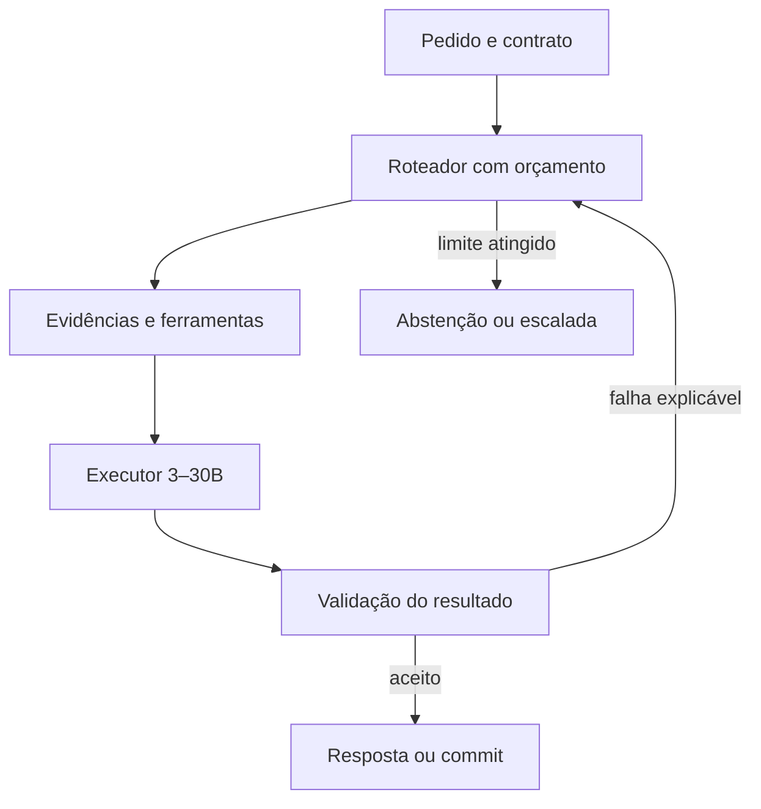

# Estratégia de produção com LLMs de 3–30B

## 1. Objetivo que pode ser verificado

O alvo útil é obter sucesso próximo de um baseline de fronteira **em uma distribuição de tarefas declarada**, com custo, latência e falhas aceitáveis. Parâmetros não são uma escala universal de inteligência. O pacote fornece conhecimento, casos e propostas; não executou modelos de 3–30B, não instalou uma plataforma em produção e não mediu equivalência com fronteira.

Escolha primeiro a unidade de resultado: pedido processado corretamente, alteração de código aceita, campo extraído com fonte ou investigação concluída com evidências. Depois defina limites de custo e prazo. Otimizar tokens/s sem contar respostas rejeitadas pode aumentar uma métrica de infraestrutura e piorar o serviço.

Uma configuração tem identidade completa: pesos/revisão, tokenizer, parâmetros totais e ativos, arquitetura, quantização, adaptador, prompt, corpus, políticas de recuperação, ferramentas, verificador, runtime e hardware. Alterar qualquer parte exige avaliar o impacto. Se o pequeno modelo encaminha casos difíceis a um professor maior, o resultado pertence ao **sistema misto**; contabilize as chamadas e não atribua todo o desempenho ao aluno.

## 2. O que a evidência industrial realmente sustenta

| Caso | Evidência e utilidade | Limite da transferência |
|---|---|---|
| Apple Foundation Models | A descrição técnica combina um modelo local de aproximadamente 3B, quantização, adaptadores e geração guiada com especulação. O framework foi disponibilizado no OS 26. | Não transformar o servidor Apple em um modelo local de 3B nem generalizar seus resultados a qualquer checkpoint. Neste acervo, o caso do framework fica conservadoramente em produto disponível. |
| Windows Click to Do / Phi Silica | Aplicação local delimitada e pilha adaptada à NPU. Documentação atual diferencia recursos NPU e GPU. | Revisões de Phi Silica não têm automaticamente o mesmo porte ou backend. Especulação NPU não é promessa de ganho no caminho GPU. |
| Learning Zone / Phi Silica LoRA | A equipe descreve dados de professor filtrados, adaptação, instrução de formato, guardrails e avaliação confrontada com humanos. | O artigo de 2025 previa public preview. Ganho relativo em perguntas Kahoot! não equivale a ganho geral de inteligência. |
| DeepSeek-R1-Distill | Modelos 7B, 8B e 14B demonstram transferência de treinamento em avaliações publicadas. | Pesquisa não prova implantação. Os comparadores são versões históricas; checkpoints de 32B e 70B ficam fora da faixa solicitada. |
| Amazon Rufus | As fontes descrevem um assistente implantado e sua infraestrutura de inferência. | Adotar um mecanismo de serving não transfere automaticamente os dados, treinamento, escala ou qualidade do Rufus. |
| LinkedIn Hiring Assistant | Caso publicado de especulação e engenharia de inferência de um produto. | Aceitação do draft, distribuição de prompts e hardware precisam ser reproduzidos; o nome da técnica não assegura o ganho. |
| Uber AutoClean | Ferramentas estruturais, avaliação por etapas e revisão formam um fluxo operacional de limpeza de código. | Uber é identificado como outro operador de tecnologia na contagem. Reproduzir a divisão de trabalho é proposta; o porte dos modelos não é inferido. |

Fontes primárias: [Apple 2025, V4D-S002](https://machinelearning.apple.com/research/apple-foundation-models-2025-updates), [release, V4D-S006](https://www.apple.com/newsroom/2025/09/apples-foundation-models-framework-unlocks-new-intelligent-app-experiences/), [Phi Silica, V4D-S003](https://learn.microsoft.com/en-us/windows/ai/apis/phi-silica), [Click to Do, V4D-S004](https://learn.microsoft.com/en-us/windows/client-management/manage-click-to-do), [Learning Zone, V4D-S012](https://blogs.windows.com/windowsdeveloper/2025/07/31/phi-silica-task-specialization-using-lora-in-microsoft-learning-zone-a-technical-deep-dive/), [DeepSeek, V4D-S010](https://github.com/deepseek-ai/DeepSeek-R1), [Rufus, V4B-S008](https://aws.amazon.com/blogs/machine-learning/how-amazon-scaled-rufus-by-building-multi-node-inference-using-aws-trainium-chips-and-vllm/), [LinkedIn, V4B-S001](https://www.linkedin.com/blog/engineering/ai/accelerating-llm-inference-with-speculative-decoding-lessons-from-linkedins-hiring-assistant), [AutoClean, V4C-S009](https://www.uber.com/us/en/blog/ai-code-cleanup/).

## 3. Distribuição de responsabilidades por porte — proposta

As faixas abaixo orientam experimentos, não classificam todo modelo desse porte como capaz de executar a tarefa. Pós-treino, idioma e domínio podem inverter a escolha.

| Faixa | Primeiro papel a testar | Redução concreta de dificuldade | Gatilho para escalada |
|---|---|---|---|
| 3–7B | Extração, classificação, seleção entre poucas ferramentas, reescrita restrita | Esquema curto, opções enumeradas, contexto recuperado por campo e cálculo em código | Violação do contrato, ausência de suporte, ambiguidade entre opções relevantes |
| 8–14B | Síntese fundamentada, cadeias curtas, interpretação de diffs e regras de domínio | Evidências separadas por afirmação, memória externa consultável e etapas verificáveis | Conflito entre fontes, múltiplas dependências ou falha após reparo limitado |
| 15–30B | Planejamento delimitado, integração entre módulos e casos difíceis do domínio | Ferramentas confiáveis, busca seletiva, checkpoints e verificador externo | Falta de evidência, incerteza calibrada ou custo de continuar superior ao de outro caminho |

Uma LLM não deve calcular aquilo que uma função precisa resolve, reter aquilo que um banco versionado resolve ou aprovar aquilo que um teste executável consegue refutar. Essa divisão diminui a quantidade de comportamento que precisa ser aprendida pelos pesos. Ela também cria novos pontos de falha: contratos errados, recuperações incompletas e validadores frágeis precisam ser medidos separadamente.

## 4. Arquitetura mínima antes de adicionar mecanismos

Comece com um modelo, um contrato de entrada/saída, um caminho de recuperação e um avaliador. Acrescente um componente somente quando um erro recorrente indicar sua necessidade. O mapa abaixo é **proposta**, não um sistema já construído neste pacote.

O laço deve ter teto de tentativas, tempo e custo. Uma escalada também pode ser uma consulta adicional, um algoritmo determinístico ou revisão humana; não precisa sempre significar um modelo maior. O estado persistente guarda o que foi confirmado e o que ainda está pendente, impedindo que uma reinicialização produza falsa conclusão.

## 5. Receita de RAG com evidência por afirmação

**Combinação proposta:** T009 → T027/T028 → T036/T037 → T141/T197 → T200. Use o grafo individual para examinar condições, não transforme essa sequência em dependência universal.

1. Decomponha a pergunta em requisitos de evidência: identidade, versão, data, valor e unidade. Uma comparação exige evidência equivalente para ambos os lados.
2. Recupere candidatos por busca lexical e vetorial quando houver embeddings avaliados. Aplique permissões e restrições temporais antes de formar o conjunto elegível.
3. Reordene por suporte à afirmação. Similaridade textual não basta para resolver negação, versão antiga ou documento de outra entidade.
4. Monte um pacote com trechos de apoio, conflitos e campos ausentes. Preserve IDs de documentos e posições de origem durante compressão.
5. Peça ao aluno uma saída curta e tipada. Cada valor deve apontar para sua evidência; campo ausente continua ausente.
6. Verifique a relação entre frase e fonte, além de validar JSON. Registre falhas de recuperação e de geração em classes diferentes.

**Aceite sugerido:** medir cobertura dos fatos necessários, suporte das citações e taxa de respostas incorretas entre as respostas aceitas. Faça ablação removendo reranker ou compressão para descobrir se o componente ajuda. Incluir um número maior de documentos pode piorar a seleção e aumentar custo; a medida relevante é evidência suficiente para o resultado.

## 6. Receita de agente que altera sistemas

**Combinação proposta:** T208 → T140/T170 → T159/T162 → T233/T243. A LLM propõe intenção e argumentos; o executor resolve identidade, versão e confirmação do efeito.

Separe a decisão semântica da transação. Um comando aceito pelo transporte ainda pode estar em execução; um timeout não demonstra que o efeito não aconteceu. Persista `operation_id`, alvo, versão esperada e recibo. Na retomada, consulte o estado remoto antes de repetir uma operação com efeito externo. Para um serviço sem idempotência, a reconciliação é parte do desenho, não um detalhe que retry resolve.

Use schemas pequenos e descoberta progressiva de ferramentas. O aluno precisa conhecer apenas as operações relevantes à etapa atual, mas o registro deve preservar versão e disponibilidade. Um argumento reparado exige revalidar a intenção; corrigir sintaxe não autoriza mudar o alvo. O verificador compara o resultado com o objetivo original e com o estado observado.

**Experimento proposto:** injete falha antes do envio, depois da aceitação remota e antes do checkpoint. Conte efeitos duplicados, efeitos sem registro local e retomadas que afirmam conclusão sem recibo. Esse ensaio avalia o sistema; aumentar o tamanho da LLM não substitui essas invariantes.

## 7. Receita de programação com contexto pequeno

**Combinação proposta:** T216/T238 → T213 → T229/T232 → T233 → T195/T217 → T236/T239.

Construa um mapa leve de símbolos e dependências. Recupere o trecho que contém a definição, seus chamadores relevantes e os testes associados. Uma micromissão deve declarar os arquivos permitidos, o comportamento a alterar e a evidência que comprovará a mudança. Quando o problema for estrutural, delegue a transformação a uma ferramenta AST; quando for textual, aplique um diff com hash da base.

O resultado só avança após validação de aplicação, compilação e testes relacionados ao comportamento. Não crie um teste que apenas repita a implementação. Congele o diff avaliado: se o agente editar de novo, o resultado anterior deixa de validar o novo conteúdo. Worktrees isolam arquivos, mas ainda podem compartilhar recursos externos; não tornam qualquer paralelismo seguro.

Um aluno 3–7B pode ajudar na seleção ou extração de contexto; 8–14B pode propor alterações pequenas; 15–30B pode integrar dependências mais amplas. Todos são papéis a medir. Uma tarefa complexa dividida incorretamente pode continuar difícil mesmo que cada subprompt seja curto.

**Base industrial relacionada:** AutoClean documenta uma combinação operacional de agente e ferramentas; Tricorder documenta análise integrada ao fluxo de revisão. Os detalhes estão em V4C-C010/V4C-C011. A receita acima é uma síntese proposta, não reprodução integral desses sistemas.

## 8. Receita de memória que não acumula erro

**Combinação proposta:** T064/T059 → T073/T072 → T067 → T069/T071 → T075/T077.

Grave eventos confirmados com origem, identidade e tempo. Diferencie tempo de validade do fato e tempo de conhecimento pelo sistema. Resumos servem como índices ou representações econômicas; mantenha referência aos eventos que permitem reabrir um detalhe. Promova uma memória porque ela satisfaz um critério de utilidade e sustentação, não porque foi repetida em vários resumos derivados da mesma origem.

Na leitura, resolva versão e conflitos antes de montar contexto. Na escrita, trate uma inferência do modelo como inferência até haver confirmação apropriada. Um catálogo de resumos contraditórios pode aparentar riqueza de conhecimento e produzir respostas menos confiáveis. Meça quanto cada política aumenta a recuperação de fatos corretos em sessões futuras e quais detalhes perde.

**Invariante:** T069 é consolidação externa por resumos. T179 é destilação paramétrica. Um arquivo persistente não altera pesos e um ajuste dos pesos não substitui um registro de evidência mutável.

## 9. Receita de especialização sem copiar erros do professor

**Combinação proposta:** T178/T180 → T182 ou T183 → T195/T200 → T198/T203.

Colete exemplos de tarefas reais e distribua por família, tempo e dificuldade. O professor produz candidatos; uma verificação independente filtra conteúdo factual, execução e formato. Guarde também razões de rejeição para orientar a próxima coleta, evitando treinar respostas que apenas satisfazem o estilo do juiz. O conjunto final deve incluir exemplos de insuficiência e de conflito, não só respostas aparentemente completas.

Separe origem de treino e avaliação antes de gerar variações. Duas perguntas extraídas do mesmo documento podem vazar informação entre conjuntos mesmo com strings diferentes. Compare aluno base, aluno com RAG, aluno com adaptador e aluno com ambos. Assim é possível descobrir se o adaptador aprendeu a tarefa ou compensou provisoriamente um corpus ruim.

Meça a redução de prompt contra regressões de comportamento. Uma habilidade aprendida não elimina a necessidade de indicar o contrato de saída. O caso Learning Zone é uma referência específica dessa interação, com limitações documentadas em V4D-C006. A aplicação para outro domínio e modelo permanece proposta.

## 10. Receita de inferência orientada ao gargalo

| Sintoma observado | Primeiro experimento proposto | Risco de escolha errada |
|---|---|---|
| TTFT cresce com prompts longos | Medir prefill separado; testar cache de prefixo válido e chunked prefill | Prefixos pouco reutilizados podem consumir memória sem economizar trabalho |
| Tokens gerados lentamente em baixa concorrência | Examinar banda de memória, kernels e hipótese de especulação | Draft e verificação podem custar mais do que a economia no alvo pequeno |
| Falta de memória com contexto/concurrência | Contabilizar pesos, KV, buffers e fragmentação; avaliar quantização KV | Evicção ou baixa precisão podem alterar qualidade ou aumentar recomputação |
| GPU ocupada, p95 pior | Examinar fila, batching, prioridade e cancelamento | Melhor ocupação não assegura entrega dentro do prazo |
| Vários dispositivos com comunicação alta | Comparar paralelismo, topologia e tamanho de mensagem | Mais GPUs podem elevar latência quando o modelo cabe em uma só |
| Muitas requisições idênticas | Avaliar coalescing ou cache de resposta com chave completa | Misturar usuário, versão ou política produz resposta incorreta reutilizada |

T079/T132 aceleram a obtenção de tokens quando as condições são favoráveis; não tornam por si só o modelo mais inteligente. T099/T100 fazem parte da arquitetura treinada e não são botões equivalentes de qualquer checkpoint. T127 é um formato, não uma garantia de método ou qualidade de quantização. As fontes de serving e suas configurações estão nas bases T079–T132 e nos casos V4B.

## 11. Orçamento de memória: estimativa transparente

Para **pesos densos**, a estimativa ideal é `parâmetros × bits / 8`. A tabela usa GB decimais e ignora escalas, metadados, buffers e KV. É aritmética de dimensionamento, não medida de VRAM nem garantia de que um modelo caiba.

| Parâmetros totais | Pesos ideais FP16 | Pesos ideais 8 bits | Pesos ideais 4 bits |
|---:|---:|---:|---:|
| 3B | 6 GB | 3 GB | 1,5 GB |
| 7B | 14 GB | 7 GB | 3,5 GB |
| 14B | 28 GB | 14 GB | 7 GB |
| 30B | 60 GB | 30 GB | 15 GB |

Para cache KV convencional, com arquitetura fixa, uma aproximação é `2 × camadas × cabeças_KV × dimensão_cabeça × tokens_residentes × bytes_por_elemento`, somada entre sequências. O fator 2 representa K e V. Há arquiteturas com representações diferentes, compartilhamento de camadas e janelas locais; a fórmula deve ser adaptada. **O KV padrão cresce linearmente com tokens residentes**, embora o cálculo de atenção densa tenha outra complexidade. A frase quadrática no blog histórico Phi Silica não foi adotada como regra de cache.

Em MoE, parâmetros ativos afetam trabalho por token; parâmetros totais continuam relevantes ao armazenamento dos pesos e à estratégia de carregamento. Um modelo de 30B totais e poucos bilhões ativos não deve ser rotulado simplesmente como um modelo que ocupa o espaço de poucos bilhões. A implantação precisa medir pico de memória e concorrência, além do tamanho do arquivo.

## 12. Critérios para declarar “próximo da fronteira”

Defina a margem máxima de perda aceitável **antes da avaliação final**, de acordo com a tarefa. Não existe margem universal. Use o mesmo conjunto de tarefas e registre diferenças de ferramentas, evidências e orçamento entre os sistemas. Compare tanto o modelo quanto o produto completo, deixando claro qual afirmação cada comparação permite.

Métricas mínimas propostas:

- Sucesso por tarefa e por subgrupo, com falhas, abstenções e timeouts no denominador.
- Erro entre resultados aceitos e cobertura das respostas; abster-se de tudo não é sucesso.
- Fidelidade de citações, validade de argumentos e efeitos externos confirmados quando aplicáveis.
- Latência de ponta a ponta p50/p95, tempo de fila, TTFT e duração até resultado aceito.
- Custo total por resultado aceito, incluindo retries, ferramentas, verificadores, professor e amortização de treino.
- Incidentes críticos observados e análise dos casos raros; ausência de incidente em amostra pequena não demonstra risco zero.

O script `runtime/compare_systems.py` analisa observações pareadas fornecidas pelo usuário. Ele calcula intervalo aproximado por bootstrap de clusters para a diferença de sucesso e verifica limites declarados de custo, latência e falhas. Não coleta dados, não executa LLMs e não certifica o juiz. Veja `avaliacao/COMPARAR_SISTEMAS.md` para o contrato.

## 13. Ordem de implementação e ablação

**Primeira etapa:** construa um conjunto representativo de tarefas, um gabarito rastreável e um executor simples. Registre erros antes de selecionar técnicas.

**Segunda etapa:** resolva ausência de conhecimento com recuperação e referências; resolva erros de formato com contratos; resolva cálculo com ferramentas; resolva retomada com estado durável. Esses mecanismos atacam causas diferentes.

**Terceira etapa:** especialize o modelo quando os erros restantes estiverem concentrados em uma habilidade aprendível e houver dados de qualidade. Mantenha conjuntos de regressão para o que já funcionava.

**Quarta etapa:** ajuste serving após identificar o gargalo. Cache, batching, quantização e especulação podem interagir; testar apenas cada opção isolada não mede a combinação final.

**Quinta etapa:** faça shadow evaluation, rollout restrito e observação por subgrupo. Congele uma versão anterior utilizável e estabeleça um critério de reversão. Essas são recomendações de implantação, não operações realizadas neste pacote.

Para cada novo mecanismo, registre hipótese, baseline, intervenção, recursos consumidos, resultado e decisão. Se não houver ganho reproduzível ou a complexidade operacional superar a utilidade, retire-o. A melhor arquitetura para uma tarefa pode usar uma fração pequena deste inventário.

## 14. Como navegar sem ruído

Abra `ABRIR_GRAFO.html`, selecione uma base e filtre pelo nível de evidência. Uma linha documentada informa uma combinação descrita na fonte, cujo estágio pode ser somente recurso disponível. Uma linha proposta informa o experimento necessário para justificá-la. A mesma empresa aparecer em dois nós não cria automaticamente uma ligação entre eles.

Cada base possui C07 para estratégias, C08 para casos/lacunas e C09 para conexões/aceite. `production_cases.json` contém os registros completos associados; `connections.json` é o contrato legível por máquina. Fontes têm data de consulta e limitações. O registro de buscas descreve o recorte pesquisado: uma lacuna significa **não comprovado nesta pesquisa**, sem afirmar que a aplicação não exista.

O acervo não é classificado como a maior fonte mundial, e o número de entradas não é número de tecnologias independentes. Densidade útil exige origem, decisão operacional, interface e teste. Crescer sem esses elementos adicionaria volume e tornaria a recuperação menos confiável.
